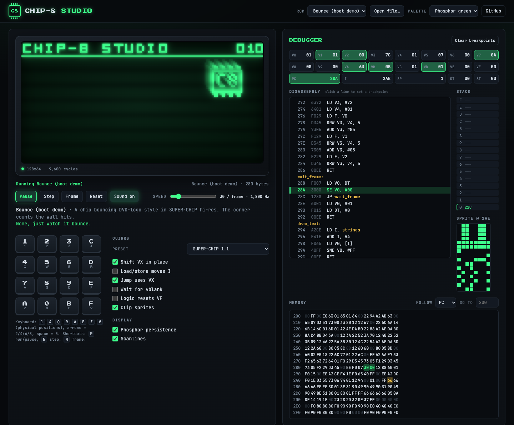
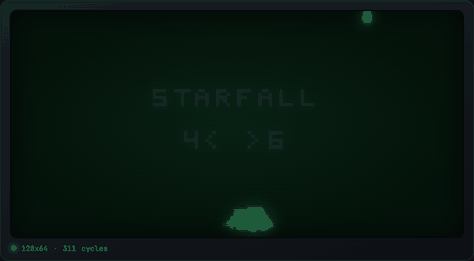

# CHIP-8 Studio

> 🇫🇷 Bienvenue ! Un émulateur CHIP-8 avec débogueur et assembleur, directement dans le navigateur.

A **CHIP-8 / SUPER-CHIP emulator** with a **visual debugger** and a **built-in assembler**, in plain JavaScript.
It runs in the browser with no build step, ships with original demo games written in its own assembler,
and lets you write a program and run it on the same page.

**▶ Live demo: https://jimmykurc.github.io/chip8-studio/**



<p align="center"></p>

## Features

**Emulator**
- The full CHIP-8 instruction set, plus SUPER-CHIP 1.1: 128x64 hi-res mode, 16x16 sprites, scrolling (`00CN`, `00FB`, `00FC`), the 8x10 big font, `EXIT` and RPL flags.
- Configurable quirks with presets (COSMAC VIP, SUPER-CHIP, Octo/XO-CHIP): shift, load/store, jump, vblank wait, VF reset and sprite clipping.
- Speed control from 1 to 200 instructions per frame, with 60 Hz timers.
- Square-wave beeper (Web Audio) driven by the sound timer, with a mute switch.
- Keyboard mapping to the hex keypad (physical keys, so it works on AZERTY too), plus an on-screen keypad for touch screens.

**Studio**
- Retro display with phosphor glow, scanlines, a persistence effect that hides CHIP-8 flicker, and six palettes.
- Live debugger: V0–VF, I, PC, SP, DT, ST (changes flash), the stack, disassembly that follows PC with label names, click-to-toggle breakpoints, step / frame step / run / pause, a memory view that follows PC or I, and a sprite preview of the bytes at I.
- Built-in **assembler** with a syntax-highlighted editor, error markers with line numbers, `Ctrl+Enter` to assemble and run, and a highlight on the source line being executed.
- Load ROMs from the menu, a file picker, or drag and drop (`.ch8` runs; `.asm` opens in the editor). Download what you assembled as `.ch8`.
- A demo starts on page load. Deep links: `#bounce`, `#catch`, `#starfall`, `#keypad`.

## Bundled ROMs

Every ROM is an original program written with the built-in assembler (MIT, same as the code). The sources are in [`roms/`](roms/) and you can open each one in the editor.

| ROM | Mode | What it is |
| --- | --- | --- |
| **Bounce** | SUPER-CHIP | The boot demo: a chip bouncing DVD-logo style, with a wall-hit counter. |
| **Catch-8** | CHIP-8 | A game: catch the falling bytes with your paddle. It speeds up as you score. |
| **Starfall** | SUPER-CHIP | A game: dodge the stars. Uses hi-res, hardware scrolling and the big font. |
| **Keypad tester** | CHIP-8 | Each key lights up while held; handy for checking input. |
| **Hello** | CHIP-8 | A commented tutorial in the editor: move a smiley with the arrow keys. |

No third-party ROMs are included. You can load your own with **Open file…** or by dropping a file on the page.

## Controls

```
CHIP-8 keypad    Keyboard
1 2 3 C          1 2 3 4
4 5 6 D          Q W E R
7 8 9 E          A S D F
A 0 B F          Z X C V
```

Arrow keys map to 2 / 4 / 6 / 8 and Space to 5. Shortcuts: `P` run/pause, `N` step, `M` one frame.

## Assembler syntax

```asm
; comments start with a semicolon
SPEED = 4                 ; constants (or: SPEED EQU 4)

start:
  CLS
  LD V0, 10               ; numbers: 10, #0A, 0x0A, $0A, 0b1010, 'A'
  LD I, sprite
  DRW V0, V0, 5
  LD V1, end - start      ; expressions with + and -
loop:
  JP loop

sprite: DB #F0, #90, #F0, #90, #F0
end:    DW 0b1000000000000001
```

Mnemonics follow the classic Cowgod reference (`LD`, `ADD`, `SE`, `DRW`, `SKP`, `LD [I], Vx`, …) plus SUPER-CHIP (`HIGH`, `LOW`, `SCD n`, `SCR`, `SCL`, `EXIT`, `LD HF, Vx`, `LD R, Vx`). Directives: `DB`, `DW`, `ORG`, `EQU` / `=`. The full table is in the page under **Instruction reference**.

## Architecture

```
index.html            the page (no build step, ES modules)
css/studio.css
src/
  core/               pure logic, no DOM: runs in Node and in the browser
    chip8.js          interpreter: memory, registers, quirks, display buffer
    disasm.js         opcode -> text (same syntax as the assembler)
    assembler.js      two-pass assembler with labels, constants and a source map
    font.js           4x5 and 8x10 fonts
  ui/
    display.js        canvas renderer, palettes, phosphor persistence
    audio.js          Web Audio beeper
    input.js          keyboard mapping and on-screen keypad
    debugger.js       registers, stack, disassembly, breakpoints, memory, sprite view
    editor.js         highlighted textarea editor with gutter and markers
  app.js              wires it together: 60 Hz loop, loading, settings
  roms.js             ROM catalog
roms/                 .asm sources and assembled .ch8 files
tools/                build-roms.js, capture.js (README media), frames-to-gif.py
test/                 node:test suites
```

The core does not know about the browser: the page calls `cpu.runFrame(n)` and `cpu.tickTimers()` once per 60 Hz frame,
then draws `cpu.screen`. That is also how the tests drive it.

## Run it locally

Any static file server works, because ES modules need `http://` rather than `file://`:

```sh
git clone https://github.com/jimmykurc/chip8-studio.git
cd chip8-studio
python3 -m http.server 8000
# open http://localhost:8000
```

## Tests

Tests use the built-in Node test runner (Node 20+, no dependencies):

```sh
node --test
```

They cover every opcode group, the SUPER-CHIP extensions, each quirk, the assembler (every instruction form, labels,
expressions, directives, error reporting), a disassembler ⇄ assembler round-trip over all 65,536 opcodes, and they check
that every shipped ROM matches its source and runs for 10 seconds under every quirk preset.

After editing a ROM source, rebuild the `.ch8` files with `node tools/build-roms.js`.

## License

[MIT](LICENSE) © Jimmy Kurc
